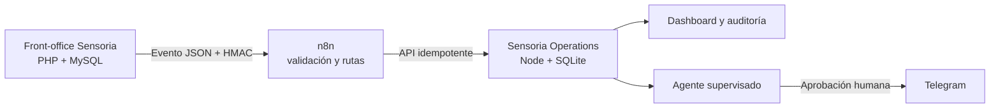

# Sensoria · Sistema Integrado de Empresa — Tarea 2

Prototipo académico completo que amplía la tienda Sensoria con un **back-office independiente**, automatización en **n8n**, integración mediante eventos firmados, trazabilidad técnica, dashboard operativo y un agente de IA supervisado.

> Todo el entorno es demostrativo: no procesa cobros ni reembolsos reales. Telegram, correo, SMS y Gemini permanecen simulados hasta configurar credenciales propias.

## Arquitectura



Los tres sistemas mantienen responsabilidades y almacenamiento separados. El front-office usa un patrón outbox para que una caída de n8n no rompa una compra; n8n valida y transforma; Operations crea o actualiza entidades, registra resultados y calcula métricas.

## Funcionalidades demostrables

- Pedido completo integrado con cliente, líneas, importes, fecha y estado.
- Productos visibles dentro de cada pedido en la tienda y en Operations.
- Sincronización de cambios de estado y stock.
- Casos de soporte y devolución asociados a cliente y pedido.
- CRM operativo con panel de métricas, segmentación, filtros, ficha 360º, notas, responsable, etiquetas, tareas, historial de contactos y seguimiento.
- Correo al administrador para devoluciones y atención al cliente, con estado `SIMULADO`, `ENVIADO` o `ERROR` visible.
- API protegida con firma HMAC SHA-256, idempotencia y validación de contratos.
- Historial de éxito/error, código de fallo, entidad creada y auditoría de actores.
- Dashboard con pedidos, ingresos simulados, casos, tiempo de resolución, tasa de integración, propuestas del agente y gráficos reales.
- Agente con herramientas de consulta de caso, cliente, pedido e historial.
- Salida estructurada: tipo, datos consultados, acción, justificación, confianza, prioridad, riesgos y estado.
- Revisión humana obligatoria antes de Telegram; no hay ejecución autónoma sensible.
- Matriz ponderada de tres alternativas tecnológicas.

## Estructura de entrega

```text
backoffice/                         Aplicación Operations independiente
automation/n8n/                    Workflow importable de n8n
contracts/                         Contratos JSON de eventos y agente
payloads/                          Tres pruebas válidas + una prueba inválida
docs/                              Arquitectura, matriz, pruebas, defensa y memoria
evidence/                          Evidencias visuales a completar con despliegue
scripts/send-event.mjs             Cliente de prueba firmado
tests/backoffice.test.mjs          Pruebas automáticas end-to-end
api/, assets/, lib/, index.php     Front-office Sensoria existente
migration_003_task2_integration.sql Migración incremental de Tarea 2
migration_004_crm.sql               Migración incremental del CRM operativo
docker-compose.yml                 Operations + n8n para desarrollo
```

## Arranque local rápido

Requiere Node.js 24 o superior. Docker es opcional.

```bash
cp backoffice/.env.example backoffice/.env
cd backoffice
npm start
```

Operations queda en `http://localhost:8080`.

El usuario y la contraseña de Operations se configuran mediante variables privadas del entorno. El repositorio no incluye contraseñas predeterminadas.

Para cargar los tres escenarios:

```bash
cd backoffice
npm run seed
```

Para ejecutar la validación automática:

```bash
cd backoffice
npm test
```

Resultado esperado: 9 pruebas superadas, cubriendo salud, acceso, firma, tres escenarios, duplicados, líneas de pedido, métricas, sincronización, agente, aprobación y regresión del CRM.

## Despliegue rápido del back-office en Render

El repositorio incluye `render.yaml`. En Render, crea un **Blueprint** desde este
repositorio y completa únicamente estas dos variables privadas cuando las solicite:

- `ADMIN_PASSWORD`: contraseña académica para entrar en Operations.
- `INTEGRATION_SHARED_SECRET`: secreto compartido con el workflow de n8n.

El servicio usa el plan gratuito y publica `/api/health` como comprobación. Debido
al almacenamiento efímero de Render Free, `SEED_DEMO_DATA=true` recupera los tres
escenarios académicos cuando el contenedor arranca con una base vacía. No se deben
usar credenciales personales ni reutilizar contraseñas reales.

## Arranque con Docker Compose

```bash
cp .env.example .env
docker compose up --build
```

- Operations: `http://localhost:8080`
- n8n: `http://localhost:5678`

En n8n importa `automation/n8n/sensoria-integration-workflow.json`, revisa las variables y activa el workflow. El contenedor permite el módulo `crypto` para volver a firmar el cuerpo exacto que recibe Operations.

## Configuración del front-office

1. Instala la tienda original con `database.sql` o, si ya existe, ejecuta en orden `migration_003_task2_integration.sql` y `migration_004_crm.sql`.
2. En `config.php` configura MySQL.
3. Para correo real, completa SMTP, cambia `MAIL_ENABLED` a `true` y define `ADMIN_NOTIFICATION_EMAIL`.
4. Para integrar n8n, configura `INTEGRATION_WEBHOOK_URL`, usa el mismo `INTEGRATION_SHARED_SECRET` en los tres sistemas y cambia `INTEGRATION_ENABLED` a `true`.
5. No publiques credenciales reales en GitHub.

Si el correo no está activado, la solicitud se guarda igualmente y el aviso aparece como `SIMULADO`. Si falla SMTP, queda como `ERROR` con su causa técnica.

## Pruebas manuales firmadas

```bash
node scripts/send-event.mjs payloads/order-created.json
node scripts/send-event.mjs payloads/order-status-changed.json
node scripts/send-event.mjs payloads/support-requested.json
```

El mismo payload repetido devuelve `duplicate: true` y no duplica el pedido. `payloads/invalid-event.json` sirve para demostrar la rama de error en n8n.

## Despliegue

- Front-office: DonDominio con PHP/MySQL.
- Operations: Railway, Render, Fly.io o servidor equivalente usando `backoffice/Dockerfile` y volumen persistente en `/app/data`.
- n8n: Railway/Render/VPS con volumen persistente y HTTPS.

Las URL finales deben sustituirse en `docs/DEPLOYMENT.md` antes de entregar. No se debe presentar localhost como despliegue válido.

## GitHub y trabajo en equipo

La rama de desarrollo es `task-2-backoffice`. Cada integrante debe realizar commits propios y reales; no se deben falsificar autores.

## Documentación

- [Arquitectura e integración](docs/ARCHITECTURE.md)
- [Matriz de decisión](docs/DECISION_MATRIX.md)
- [Plan y resultados de prueba](docs/TEST_PLAN.md)
- [Guion de defensa de 7 minutos](docs/DEFENSE_7_MIN.md)
- [Anexo de uso de IA](docs/AI_USE_ANNEX.md)
- [Lista final de evidencias](docs/EVIDENCE_CHECKLIST.md)
- [Despliegue](docs/DEPLOYMENT.md)

## Limitaciones declaradas

- SQLite es suficiente para la demostración, no para alta concurrencia sin migrar a PostgreSQL.
- Las sesiones del back-office están en memoria; un entorno multiinstancia necesitaría Redis o sesiones persistentes.
- Telegram solo se ejecuta de verdad cuando hay token y chat configurados; por defecto queda simulado.
- El modo sin clave Gemini usa reglas deterministas y mantiene el mismo contrato estructurado.
- El workflow debe importarse, configurar sus variables y activarse en el n8n desplegado.
