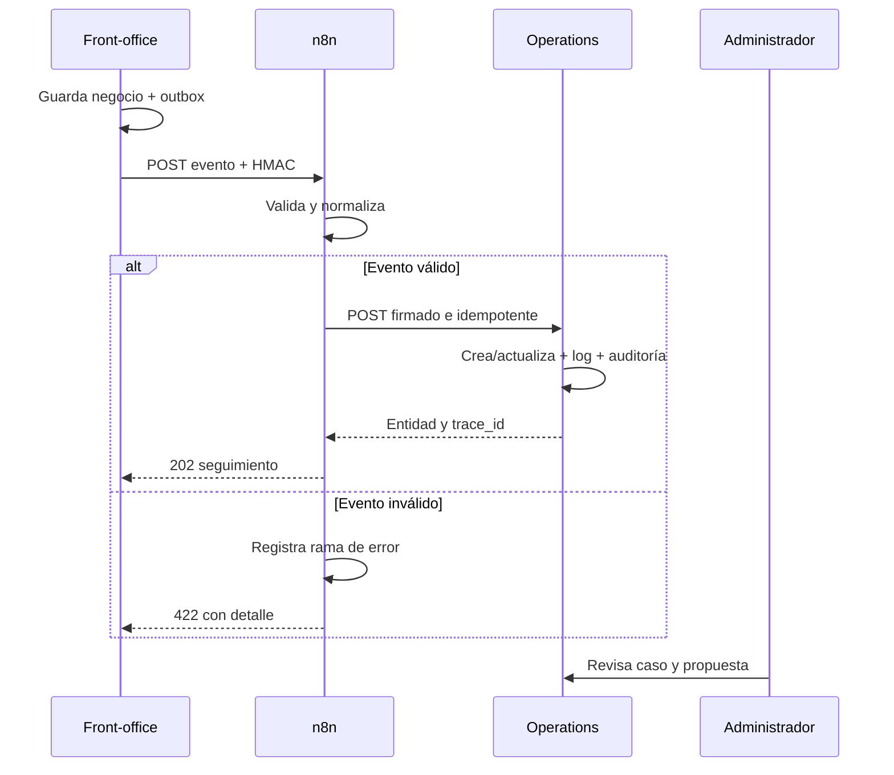

# Arquitectura e integración

## Objetivo

Separar la experiencia de compra de la operación interna. La tienda no comparte tablas con Operations: comunica hechos de negocio por eventos y cada sistema persiste lo necesario en su propio almacenamiento.

## Componentes

| Sistema | Responsabilidad | Tecnología | Datos propios |
|---|---|---|---|
| Sensoria Store | Catálogo, carrito, pedidos, cuenta y soporte | PHP + MySQL | productos, pedidos, devoluciones, outbox |
| n8n | Recepción, validación, normalización, rutas y reintentos | n8n + Code JavaScript | ejecuciones del workflow |
| Sensoria Operations | Gestión, dashboard, casos, auditoría y agente | Node.js + SQLite | pedidos integrados, casos, inventario, propuestas, logs |

## Flujo de evento

## Contrato común

Todos los eventos contienen `event_id`, `event_type`, `occurred_at`, `source`, `idempotency_key` y `payload`. Los esquemas se entregan en `contracts/`. La cabecera `X-Sensoria-Signature` contiene un HMAC SHA-256 sobre los bytes exactos del JSON y `X-Idempotency-Key` permite reintentar sin duplicar.

## Escenarios

1. `order.created`: crea o actualiza cliente, pedido y líneas dentro de una transacción.
2. `order.status_changed` o `stock.changed`: sincroniza un cambio operativo.
3. `support.requested`, `return.requested` o `incident.created`: crea caso y lo asocia con cliente y pedido si existen.

## Trazabilidad

`integration_events` guarda recepción, estado, código de error, mensaje, entidad y fechas. `audit_log` registra actor, acción, entidad y detalle. `integration_outbox` conserva lo que intentó publicar la tienda, incluidos HTTP, número de intentos y error. El `trace_id` coincide con `event_id` de extremo a extremo.

## Seguridad y resiliencia

- HMAC con comparación temporalmente segura.
- Validación antes de escribir datos.
- Idempotencia por dos claves únicas.
- Transacciones para pedido y líneas.
- Outbox no bloqueante en el front-office.
- Cookies HttpOnly y SameSite Strict.
- CSP, anti-framing y no-sniff.
- Secretos solo mediante entorno en despliegue.
- La IA nunca envía una respuesta sin aprobación humana.

## Agente supervisado

La herramienta de consulta recupera caso, cliente, pedido, líneas e historial. La herramienta de acción genera una propuesta estructurada y la guarda como `PENDIENTE_REVISION`. Un administrador puede rechazar o aprobar. Solo tras aprobar se intenta Telegram y la decisión queda auditada.
